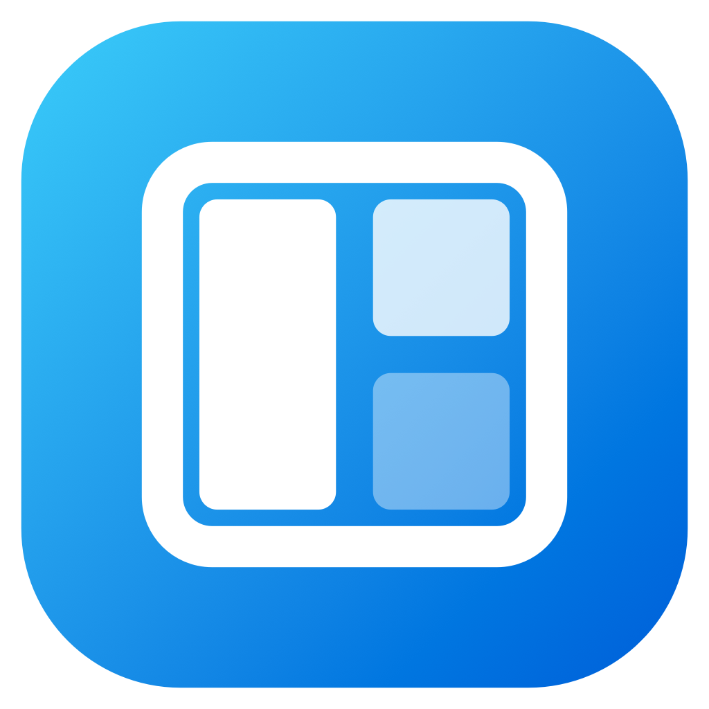

<p align="center">
  
</p>

<h1 align="center">Snapper</h1>

<p align="center">
  <b>Windows 11 style Win+Arrow window snapping for macOS. Tiny, offline, no dependencies.</b><br>
  no network access &middot; 0% CPU when idle &middot; macOS 13+
</p>

Keyboard-driven window snapping with the same muscle memory as Windows: arrow keys snap to halves and quarters,
maximize, restore, minimize and hop between displays. It lives in the menu bar, starts at login, never touches the
network, and is a few hundred lines of Swift you can read.

## Using it

Hold the modifier (**⌃⌥** by default, changeable from the menu-bar icon) and press an arrow key.

| Keys | Behaviour |
|---|---|
| ⌃⌥← / ⌃⌥→ | Snap to the left/right half. From the opposite half: restore. At the screen edge: continue onto the next display, wrapping around from the last to the first. |
| ⌃⌥↑ | Maximize. From maximized: top half (and it stays there). From a half: top quarter. From a bottom quarter: the half. |
| ⌃⌥↓ | From maximized or the top half: restore. From a half: bottom quarter. From a top quarter: the half. From a bottom quarter or a normal window: minimize (toggle in the menu). |
| ⌃⌥⌘↑ / ⌃⌥⌘↓ | **Top / bottom half** of the screen (Windows: Win+Alt+↑/↓). |
| ⌃⌥⇧← / ⌃⌥⇧→ | Move to the display on the left/right, keeping the snap position (wraps around). |

On a Mac keyboard Option sits where the Windows key does and Command where Alt does, so "Win+Alt" becomes
*your modifier + ⌘*. (If your modifier already includes ⌘, the halves use +⇧.) The menu always shows the exact keys
for the current setting.

The mapping follows Microsoft's published Windows 11 shortcut list (Win+↑ maximize, Win+↓ minimize, Win+←/→ halves,
Win+Alt+↑/↓ top/bottom half, Win+Shift+←/→ other monitor). Microsoft doesn't document the multi-step sequences
(e.g. ← then ↑ for a quarter); those follow observed behaviour. Not implemented: Win+Shift+↑/↓ (vertical stretch).

Plain ⌘+Arrow isn't offered: it's line/document navigation in every app. The shortcuts work everywhere, including
while a text field has focus, so the **Option**-only preset overrides word-by-word cursor movement (⌥←/→); the default
⌃⌥ doesn't.

### Menu-bar menu

The current shortcuts, **Shortcut Keys** (⌥, ⌃⌥, ⌃⌘ or ⌃⌥⌘), **Down Arrow Minimizes Window** (on/off), **Launch at
Login** (on/off, on by default after the first run), and Quit.

## Install

Installs from source, per user, without admin rights. Needs the Xcode command-line tools
(`xcode-select --install`).

```bash
./install.sh
```

This builds a release binary, assembles `~/Applications/Snapper.app`, signs it locally and launches it; a window-grid
icon appears in the menu bar. On first launch grant **System Settings > Privacy & Security > Accessibility** to
Snapper (it is needed to move other apps' windows); the shortcuts start working as soon as you allow it. Optional: run
`./scripts/create-signing-identity.sh` once beforehand so the permission survives rebuilds.

- **Starting Snapper again:** open it from Applications, Spotlight or Launchpad; turn *Launch at Login* back on from
  its menu.
- **Update:** `git pull && ./install.sh`. **Uninstall:** `./uninstall.sh`.

## Privacy and footprint

- No network code. Nothing is stored except three settings (shortcut modifier, down-arrow behaviour, login item
  choice) in the `com.thoeksema.Snapper` `defaults` domain.
- The log (`~/Library/Logs/Snapper/snapper.log`) records lifecycle events and errors, never key presses, window
  titles or window contents.
- Idle: 0% CPU, no timers or polling once Accessibility is granted.
- **Shortcuts** use a session event tap that looks at arrow keys with exactly your modifier held and passes every
  other key through untouched. That is what needs the Accessibility permission, which is also what moving other apps'
  windows needs.

## Known limits

- Full-screen windows (their own Space) are left alone, as are apps that don't expose their windows through
  Accessibility.
- Apps with a minimum window size can't always reach the exact rect; Snapper remembers where the window ended up so
  repeated presses still follow the sequence.
- Not notarized: build it on the Mac that runs it. Without a signing identity the build is ad-hoc signed, so macOS
  may ask you to re-grant Accessibility after each rebuild.
- If another tool (Rectangle, Magnet, ...) uses the same keys, quit it or pick a different modifier.

## Development

| | |
|---|---|
| Build | `swift build` |
| Unit tests | `swift test` |
| Install locally | `./install.sh` |
| Diagnostics | `Snapper --diagnostics`, `~/Library/Logs/Snapper/snapper.log` |
| CI | `.github/workflows/mac.yml` (build, tests, packaging) |

The logo is drawn by `scripts/render-logo.swift` (`swift scripts/render-logo.swift docs/logo.png`); the app icon is
built from it by `scripts/make-icon.sh` during install.

## Contributing

Read [AGENTS.md](AGENTS.md) (principles, hard rules and the PR review checklist) and
[docs/architecture.md](docs/architecture.md) (how the shortcuts, the snap rules and window placement work) first.
Product changes are discussed before they're built.

## License

[MIT](LICENSE). Snapper bundles no third-party code or assets.
